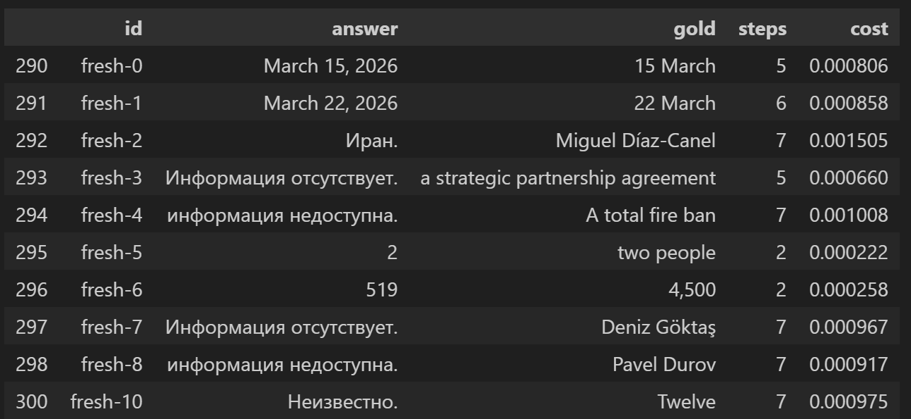
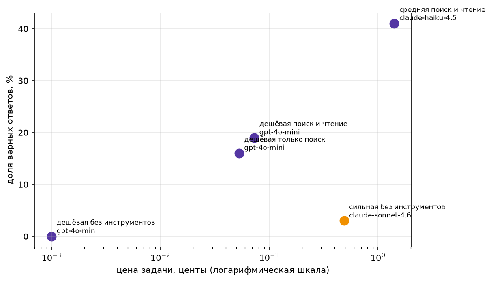

# Домашнее задание 1

Выбран вариант расширения стартового набора: 125 вопросов семинара дополнены 20 вопросами о состоявшихся выпусках моделей и развитии их возможностей в 2025–2026 годах. Итого 145 записей в `data/fresh.jsonl`. Новые факты взяты из открытых анонсов OpenAI, Google и Meta.

```bash
python check_fresh.py data/fresh.jsonl --sonnet
```
**Фактический вывод проверки Sonnet:**

```text
записей: 20, проблем: 0

Sonnet без инструментов: 1 из 20 верно, 5%. Потрачено $0.037
критерий свежести пройден
  ai-release-19: Какая техника настройки гиперпараметров описана Meta при релизе Llama 4 Scout и Maverick в -> При релизе Llama 4 Scout и Mave
  
```

## Итоговая таблица

Результат полного прогона пяти обязательных конфигураций на 145 вопросах (по выводу ноутбука от 29.09.2026).

| Конфигурация | Доля верных | Цена задачи, $ | Цена верного, $ | Шаги | Время, с |
| --- | ---: | ---: | ---: | ---: | ---: |
| GPT-4o mini без инструментов | 0,00 | 0,00001 | не определена | 1,00 | 3,0 |
| GPT-4o mini, только поиск | 0,16 | 0,00053 | 0,00336 | 4,48 | 25,2 |
| GPT-4o mini, поиск и чтение | 0,19 | 0,00073 | 0,00393 | 4,92 | 26,0 |
| Claude Sonnet 4.6 без инструментов | 0,03 | 0,00488 | 0,14160 | 1,00 | н/д¹ |
| Claude Haiku 4.5, поиск и чтение | 0,41 | 0,01412 | 0,03412 | 3,70 | 23,4 |

¹ В старых JSON-трейсах Sonnet не было длительности. Известное среднее по части вопросов нельзя выдавать за среднее по всем 145.



**Фактическая стоимость полного эксперимента:** составила 2.94 доллара.

**Результаты трейсов**
Пример трейсов для дешевой модели с поиском и чтением:


Разберем, что же пошло не так на примере fresh-6, какой провал произошел:
```text
Вопрос: How many people are reported missing in Tibet after the floods in August 2026?
Эталон: 4,500
Ответ агента: After the floods in August 2026, 519 people were reported missing in the Tibet Autonomous Region of China. 

FINAL: 519
system  Ты решаешь задачи. На вопросы по-русски можешь искать в ru.wikipedia.org (language=ru), затем читать статью с тем же language. Для фактов о новых моделях проверь официальные анонсы через source_search/source_find. Если нужно посчитать или найти факт, вызывай инструменты, а не угадывай. Когда ответ готов, напиши его последней строкой в формате FINAL: <ответ>. Для числовых задач в FINAL только число, для вопросов о фактах короткая фраза.
user  How many people are reported missing in Tibet after the floods in August 2026?
assistant [{'type': 'function', 'index': 0, 'id': 'call_ZqbZu1eSi24IlJ0BU1DRTWd7', 'function': {'name': 'web_search', 'arguments': '{"query":"Tibet floods August 2026 missing people","language":"en"}'}}] 
tool  [en:2026 Nepal–Tibet floods] On the morning of 26 August 2026, a series of flash floods and debris flows destroyed the Gyirong Port on the China–Nepal border and struck dozens of settlements along a 72 km (45 mi) stretch of the Trishuli River in Nepal. These events are also known as the 2026 Nepal-China floods, Bhotekoshi flood, or Rasuwa flood. At least 1,451 deaths and 5,745 missing persons in Nepal, and 43 deaths and 519 missing in the Tibet Autonomous Region of China were reported. The flood carried the bodies of some victims 240 km (150 mi) away into neighbouring India. Authorities issued flood warnings for communities along rivers in the Nepali districts of Rasuwa, Nuwakot, Dhading, Gorkha, and Chitwan. The precipitating geological event, initially reported as a glacier collapse in the Langtang region of the Himalayas, caused a chain reaction whose tremors were detected by seismometers worldwide, with magnitudes reaching Ms 5.2. According to experts at the National Society for Earthquake Technology–Nepal (NSET), the University of Reading and Newcastle University, the flood was triggered by a large rock-ice avalanche originating from the Lirung massif, involving glacier ice and rock, which transformed into a highly mobile, long-runout debris flow and generated destructive downstream flooding. | Other titles: ['Timeline of the 2026 Nepal–Tibet floods', 'Weather of 2026']
assistant  After the floods in August 2026, 519 people were reported missing in the Tibet Autonomous Region of China. 

FINAL: 519
```
Он посчитал буквально пропавших без вести людей (а их и правда было 519), хотя в запросе формулируется пропавшие, в смысле погибшие. Модель запуталась в том, что надо было выдать, и даже скорее вопрос был некорректный, что она дала неверный ответ.

И разберем, что же пошло не так на примере fresh-2, какой провал произошел:
```text
Вопрос: Who entered negotiations with the Trump administration on March 13, 2026?
Эталон: Miguel Díaz-Canel
Ответ агента: На 13 марта 2026 года в переговоры с администрацией Трампа вступила Иранская сторона. FINAL: Иран.
system  Ты решаешь задачи. На вопросы по-русски можешь искать в ru.wikipedia.org (language=ru), затем читать статью с тем же language. Для фактов о новых моделях проверь официальные анонсы через source_search/source_find. Если нужно посчитать или найти факт, вызывай инструменты, а не угадывай. Когда ответ готов, напиши его последней строкой в формате FINAL: <ответ>. Для числовых задач в FINAL только число, для вопросов о фактах короткая фраза.
user  Who entered negotiations with the Trump administration on March 13, 2026?
assistant [{'type': 'function', 'index': 0, 'id': 'call_3G7hMA6Ri6fPJ72asFltrr6E', 'function': {'name': 'web_search', 'arguments': '{"query":"negotiations Trump administration March 13 2026","language":"en"}'}}] 
tool  [en:2025–2026 Iran–United States negotiations] In 2025 and 2026, Iran and the United States began a series of negotiations aimed at reaching a nuclear peace agreement, following a letter from US president Donald Trump to Iranian supreme leader Ali Khamenei, setting a 60-day deadline for Iran to reach an agreement. After the deadline passed without an agreement in June 2025, Israel launched airstrikes against Iran, starting the Twelve-Day War. As of June 28, 2026, there were three rounds of talks before the Islamabad talks that led to the Islamabad Memorandum, and two rounds of technical talks. The first round was held in Oman on April 12, 2025, led by US special envoy Steve Witkoff and Iranian foreign minister Abbas Araghchi. A second round of Omani-mediated talks took place in Rome on April 19, 2025, again between Witkoff and Araghchi. This was followed by a third round in Muscat around a week later; an expert-level meeting to develop a framework for a possible nuclear agreement was led by Michael Anton for the US and by Majid Takht-Ravanchi for Iran. The US military had been building up its presence in the Middle East as the threat of war escalated. US bases throughout the region accommodate approximately 50,000 American troops. As part of the peace proposals, Iran proposed building at least 19 additional reactors, suggesting that American involvement in these projects could help revitalize the US nuclear industry. A planned address by Araghchi to formally announce this pro
assistant [{'type': 'function', 'index': 0, 'id': 'call_GFfgGuQuz3vQlGO5Qr1qeTVQ', 'function': {'name': 'page_find', 'arguments': '{"title":"2025–2026 Iran–United States negotiations","keywords":"March 13 2026","language":"en"}'}}] 
tool  In 2025 and 2026, Iran and the United States began a series of negotiations aimed at reaching a nuclear peace agreement, following a letter from US president Donald Trump to Iranian supreme leader Ali Khamenei, setting a 60-day deadline for Iran to reach an agreement. After the deadline passed without an agreement in June 2025, Israel launched airstrikes against Iran, starting the Twelve-Day War. As of June 28, 2026, there were three rounds of talks before the Islamabad talks that led to the Islamabad Memorandum, and two rounds of technical talks.
On June 13, Israel launched large-scale attacks targeting Iran's military leadership and nuclear scientists. Consequently, Iran withdrew and suspended nuclear talks indefinitely. The United States also carried out a series of strikes on Iranian nuclear sites and negotiations between the United States and Iran were subsequently suspended. Talks resumed in early 2026 after large-scale protests in Iran. Meanwhile, the US military buildup in the Middle East continued.
On February 28, 2026, the United States and Israel launched large-scale strikes on Iran, marking the start of the 2026 Iran war. The attacks included the assassination of Khamenei, as well as the assassination of Ali Larijani, a key figure in the negotiations. On April 7, 2026, Iran and the United States announced a temporary two-week ceasefire.
On May 24, 2026, reports indicated that the United States and Iran were nearing a broader peace agreement following months of con
assistant [{'type': 'function', 'index': 0, 'id': 'call_B3mnFhMiYQaTBwDSs4bhIYO2', 'function': {'name': 'web_search', 'arguments': '{"query":"Trump administration negotiations March 13 2026","language":"en"}'}}] 
tool  [en:2025–2026 Iran–United States negotiations] In 2025 and 2026, Iran and the United States began a series of negotiations aimed at reaching a nuclear peace agreement, following a letter from US president Donald Trump to Iranian supreme leader Ali Khamenei, setting a 60-day deadline for Iran to reach an agreement. After the deadline passed without an agreement in June 2025, Israel launched airstrikes against Iran, starting the Twelve-Day War. As of June 28, 2026, there were three rounds of talks before the Islamabad talks that led to the Islamabad Memorandum, and two rounds of technical talks. The first round was held in Oman on April 12, 2025, led by US special envoy Steve Witkoff and Iranian foreign minister Abbas Araghchi. A second round of Omani-mediated talks took place in Rome on April 19, 2025, again between Witkoff and Araghchi. This was followed by a third round in Muscat around a week later; an expert-level meeting to develop a framework for a possible nuclear agreement was led by Michael Anton for the US and by Majid Takht-Ravanchi for Iran. The US military had been building up its presence in the Middle East as the threat of war escalated. US bases throughout the region accommodate approximately 50,000 American troops. As part of the peace proposals, Iran proposed building at least 19 additional reactors, suggesting that American involvement in these projects could help revitalize the US nuclear industry. A planned address by Araghchi to formally announce this pro
assistant [{'type': 'function', 'index': 0, 'id': 'call_pDUQ8tp4tKA09JcQZlhrKz79', 'function': {'name': 'web_search', 'arguments': '{"query":"Trump administration negotiations March 2026","language":"en"}'}}] 
tool  [en:2025–2026 Iran–United States negotiations] In 2025 and 2026, Iran and the United States began a series of negotiations aimed at reaching a nuclear peace agreement, following a letter from US president Donald Trump to Iranian supreme leader Ali Khamenei, setting a 60-day deadline for Iran to reach an agreement. After the deadline passed without an agreement in June 2025, Israel launched airstrikes against Iran, starting the Twelve-Day War. As of June 28, 2026, there were three rounds of talks before the Islamabad talks that led to the Islamabad Memorandum, and two rounds of technical talks. The first round was held in Oman on April 12, 2025, led by US special envoy Steve Witkoff and Iranian foreign minister Abbas Araghchi. A second round of Omani-mediated talks took place in Rome on April 19, 2025, again between Witkoff and Araghchi. This was followed by a third round in Muscat around a week later; an expert-level meeting to develop a framework for a possible nuclear agreement was led by Michael Anton for the US and by Majid Takht-Ravanchi for Iran. The US military had been building up its presence in the Middle East as the threat of war escalated. US bases throughout the region accommodate approximately 50,000 American troops. As part of the peace proposals, Iran proposed building at least 19 additional reactors, suggesting that American involvement in these projects could help revitalize the US nuclear industry. A planned address by Araghchi to formally announce this pro
assistant [{'type': 'function', 'index': 0, 'id': 'call_a2clovCykgmM58VKCMmJHiSc', 'function': {'name': 'web_search', 'arguments': '{"query":"Trump administration March 2026","language":"en"}'}}] 
tool  [en:Second presidency of Donald Trump] Donald Trump's second and current tenure as the president of the United States began upon his inauguration as the 47th president on January 20, 2025. Trump, a Republican, previously served as the 45th president from 2017 to 2021. He lost re-election to Democratic nominee Joe Biden in 2020, and then won against Democratic nominee Kamala Harris in 2024. Trump is the second former U.S. president to return to office. Alongside Trump's second presidency, the Republican Party also currently holds simple majorities in the House of Representatives and the Senate, thereby attaining an overall federal government trifecta. During 2025, Trump signed 225 executive orders, the most of any president in a single year since Franklin D. Roosevelt. Many of these have been or are being challenged in court. His attempts to expand presidential power and conflict with the courts have been described as a defining characteristic of his second presidency. On immigration, Trump signed the Laken Riley Act into law, attempted to restrict birthright citizenship, and ordered mass deportations of immigrants. In January 2025, Trump launched the Department of Government Efficiency (DOGE), with Elon Musk briefly overseeing it. DOGE was tasked with reducing federal spending and shrinking the size of the government, and it oversaw mass layoffs of civil servants, as well as closing government agencies such as the Agency for International Development. Trump also signed the On
user  Инструменты больше недоступны. Ответь по тому, что уже известно, последней строкой FINAL: <ответ>.
assistant  На 13 марта 2026 года в переговоры с администрацией Трампа вступила Иранская сторона. FINAL: Иран.
```
В выводе от модели вообще не встречается имя Miguel Díaz-Canel, хотя на вопрос КТО, модель могла выдать не страну, а хотя бы человека, от лица которого вели переговоры.


## Вывод по тезису курса

На этом наборе показало, что GPT-4o mini без инструментов дала 0% верных, а с поиском — 16% при цене верного ответа $0,00336. С поиском и чтением точность выросла до 19%, что выше 3% у Sonnet 4.6 без инструментов; цена верного ответа составила $0,00393 против $0,14160. Чтение добавило около 3 процентных пунктов к точности относительно одного поиска, но повысило цену верного ответа с $0,00336 до $0,00393. Поэтому оно улучшило качество, но на этом наборе не дало сэкономить на более дешёвом агента.

Haiku 4.5 с теми же инструментами дала наибольшую точность — 41%, но цена верного ответа $0,03412 примерно в 8,7 раза выше, чем у GPT-4o mini с поиском и чтением.